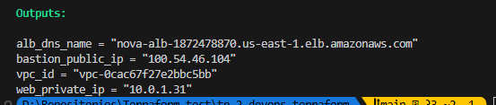
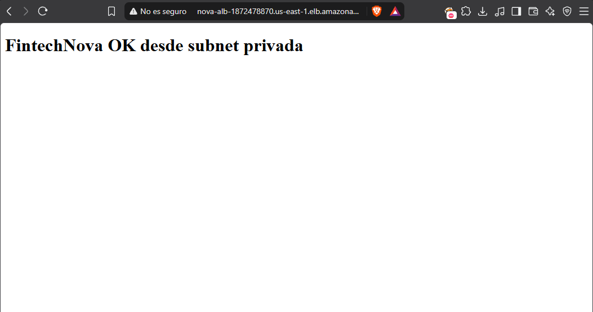
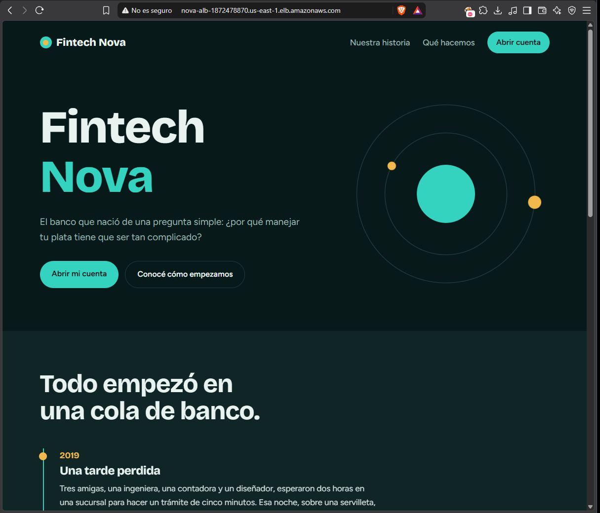
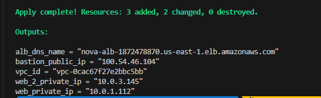
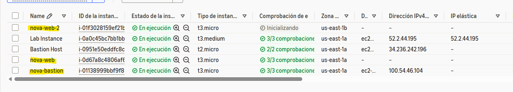

# Proyecto FintechNova — Infraestructura con Terraform (`tp-2-devops-terraform`)

Práctica de Infraestructura como Código (IaC) con **Terraform** sobre **AWS** (`us-east-1`), desplegada en entorno sandbox (AWS Academy / `voclabs`).

El proyecto levanta una VPC segmentada en subredes públicas y privadas en dos zonas de disponibilidad (`us-east-1a` y `us-east-1b`), un **Bastion Host** para administración por SSH, un **Application Load Balancer (ALB)** público y dos instancias EC2 web privadas que sirven la página estática de **Fintech Nova** ([`../index.html`](../index.html)).

---

## Estructura y documentación relacionada

- **Diagrama de arquitectura:** [`arquitecture.md`](./arquitecture.md)
- **Cuaderno de anotaciones y comandos:** [`Anotaciones.md`](../../Anotaciones.md)
- **Registro de errores y soluciones:** [`ERRORES.md`](../../ERRORES.md)
- **Código Terraform:**
  - [`terraform.tf`](../terraform.tf): configuración de provider (`hashicorp/aws` `5.87.0`) y `default_tags`.
  - [`variables.tf`](../variables.tf): zonas de disponibilidad (`var.az` y `var.az_2`).
  - [`main.tf`](../main.tf): VPC, subredes, IGW, tabla de ruteo, Security Groups, ALB, Target Group, instancias EC2 y `user_data`.
  - [`output.tf`](../output.tf): salidas (`vpc_id`, `alb_dns_name`, `bastion_public_ip`, `web_private_ip`, `web_2_private_ip`).
  - [`index.html`](../index.html): landing page de Fintech Nova cargada en las instancias mediante `filebase64()`.

---

## Cómo desplegar y probar

```powershell
# 1. Inicializar providers
terraform -chdir=tp-2-devops-terraform init

# 2. Validar sintaxis y referencias
terraform -chdir=tp-2-devops-terraform validate

# 3. Revisar plan y aplicar cambios
terraform -chdir=tp-2-devops-terraform plan
terraform -chdir=tp-2-devops-terraform apply
```

- **Acceso web:** abrir `http://<alb_dns_name>` (el tráfico entra al ALB por puerto `80` y se distribuye entre `nova-web` y `nova-web-2`; las instancias privadas no tienen IP pública ni acceso directo desde internet).
- **Acceso SSH vía Bastion (`ProxyJump`):**
  ```bash
  ssh -i <ruta_a_vockey.pem> -J ec2-user@<bastion_public_ip> ec2-user@<web_private_ip>
  ```
- **Limpieza:** ejecutar `terraform destroy` al finalizar la sesión para no consumir créditos del sandbox.

---

## Evidencia de pruebas y capturas

### 1. Primer despliegue exitoso con una EC2 privada
Salidas generadas por Terraform tras levantar la VPC, el ALB, el Bastion y la primera instancia `nova-web`:



### 2. Prueba inicial de respuesta del ALB desde subnet privada
Verificación de que el ALB alcanzaba el puerto `80` de `nova-web` en la subred privada:



### 3. Renderizado de la landing page `Fintech Nova`
Despliegue de [`index.html`](../index.html) mediante `user_data` y `python3 -m http.server 80` servido a través del ALB:



### 4. Incorporación de la segunda subred privada y segunda EC2 Web
Actualización agregando `privada_2` (`us-east-1b`) y `nova-web-2` conectadas al mismo Target Group:



### 5. Instancias activas en la consola de AWS EC2
Vista de consola mostrando `nova-bastion` (pública en `us-east-1a`), `nova-web` (privada en `us-east-1a`) y `nova-web-2` (privada en `us-east-1b`):


