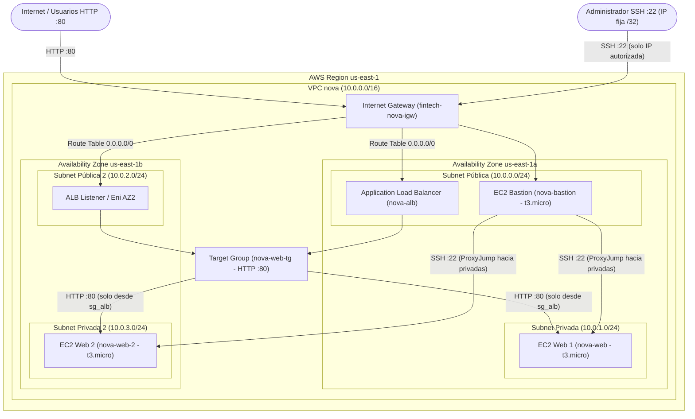

# Arquitectura — FintechNova (`tp-2-devops-terraform`)

Diagrama representativo de la infraestructura desplegada en AWS (`us-east-1`) mediante Terraform.

## Diagrama general



## Vista en ASCII (redes, Security Groups y flujo)

```text
Internet
  ├── HTTP :80 ──► [ IGW ] ──► [ ALB "nova-alb" (sg_alb) ]  (Subnets públicas: 10.0.0.0/24 & 10.0.2.0/24)
  │                                     │
  │                              HTTP :80 (Target Group "nova-web-tg")
  │                          ┌──────────┴──────────┐
  │                          ▼                     ▼
  │                 [ EC2 nova-web ]      [ EC2 nova-web-2 ]
  │                 (10.0.1.0/24 a)       (10.0.3.0/24 b)
  │                 (sg_web, sin IP pub)  (sg_web, sin IP pub)
  │                          ▲                     ▲
  └── SSH :22 ──► [ IGW ] ───┴── [ Bastion (sg_bastion) ] (10.0.0.0/24 a)
      (solo IP admin /32)            SSH :22
```

## Resumen de componentes y reglas de seguridad

| Capa | Recurso | Red / AZ | Reglas principales |
| --- | --- | --- | --- |
| **Red** | `aws_vpc.nova` | `10.0.0.0/16` | `enable_dns_hostnames = true` |
| **Subnets públicas** | `publica` / `publica_2` | `10.0.0.0/24` (`1a`) / `10.0.2.0/24` (`1b`) | Asociadas a `aws_route_table.publica` → IGW |
| **Subnets privadas** | `privada` / `privada_2` | `10.0.1.0/24` (`1a`) / `10.0.3.0/24` (`1b`) | Sin IP pública ni ruta directa a internet |
| **Balanceador** | `aws_lb.nova` (`sg_alb`) | `publica` + `publica_2` | Ingress `80` desde `0.0.0.0/0`; Egress `80` hacia `privada` y `privada_2` |
| **Bastion** | `aws_instance.bastion` (`sg_bastion`) | `publica` (`us-east-1a`) | Ingress `22` desde IP admin `/32`; Egress `22` hacia `privada`/`privada_2` y `443` a `0.0.0.0/0` |
| **Servidores Web** | `web` / `web_2` (`sg_web`) | `privada` (`1a`) / `privada_2` (`1b`) | Ingress `80` solo desde `sg_alb`; Ingress `22` solo desde `sg_bastion` |
